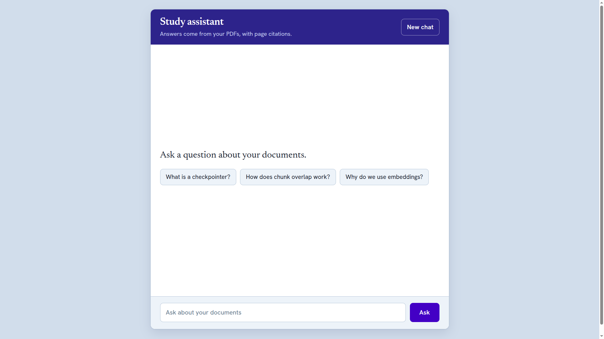

# [Project name] – RAG Chatbot with Memory



A chatbot that answers questions about [your PDFs, e.g. PNY Agentic AI lectures],
cites the source file and page, and remembers the conversation.


## How it works

```
Browser (HTML/CSS/JS)
   │  POST /chat  { question, thread_id }
   ▼
Flask API (app.py)
   ▼
LangChain agent + Groq LLM ── memory per thread_id (InMemorySaver)
   │  decides to call the search tool
   ▼
search_knowledge → vector store (PDF chunks as embeddings, saved in index/)
```

1. **Ingest (once):** PDFs are read page by page, split into chunks, embedded
   with `all-MiniLM-L6-v2`, and saved to `index/`.
2. **Ask:** the agent decides when to search, reads the top passages, and answers
   only from them, citing `(file, page)`.
3. **Remember:** a checkpointer keeps each conversation under its own `thread_id`.

## Tech stack
Python, LangChain, Groq (LLM), HuggingFace sentence-transformers, Flask, flask-cors,
pypdf, HTML/CSS/JavaScript.

## Setup
```bash
git clone https://github.com/Ameershahkhan/rag-chatbot.git
cd rag-chatbot
python3 -m venv .venv
source .venv/bin/activate
pip install -r requirements.txt
cp .env.example .env        # then put your Groq key in .env
```
Put your text-based PDFs in `knowledge/`, set `TOPIC` in `rag_core.py`, then:

```bash
python ingest.py            # build the index
python app.py               # backend on http://localhost:5000
cd frontend && python3 -m http.server 8000   # then open http://localhost:8000
```

## Project structure
- `app.py` – Flask API (`/health`, `/chat`)
- `rag_core.py` – loading, chunking, embeddings, index, agent
- `ingest.py` – builds the vector index
- `frontend/` – chat page
- `learning-steps/` – the step-by-step scripts I wrote while learning

## Limitations and next steps
- Memory is in RAM and is lost on server restart (next: a database-backed checkpointer)
- Scanned PDFs need OCR
- No streaming of answers yet